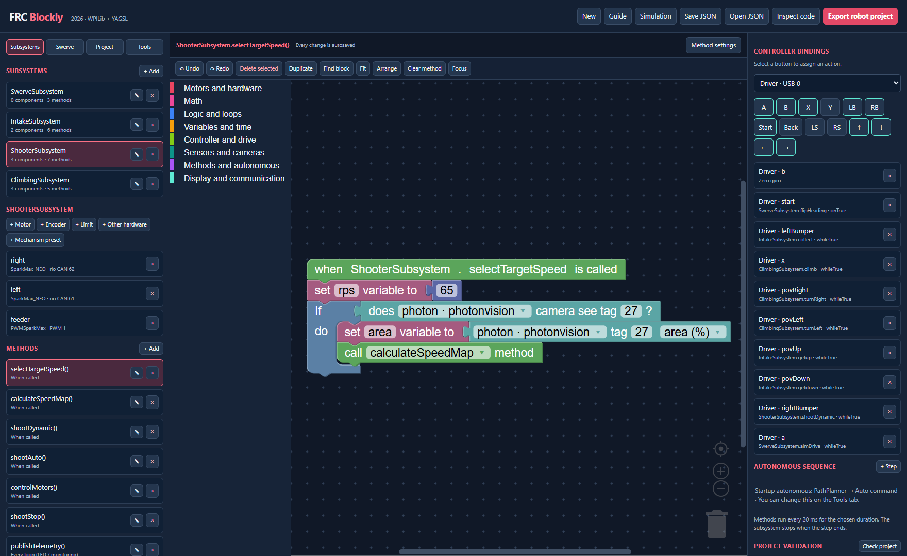

# FRC Blockly Studio

Build FRC robot behavior with Blockly, configure the hardware, and export a WPILib 2026 Java project.

FRC Blockly Studio is an offline visual programming workspace. Its focus is the editor and code generator: motors, sensors, math, conditions, variables, timing, controller bindings, and autonomous commands. Mechanisms are assembled from those basic operations rather than hidden behind a dedicated “shooter system” block.



## Run the editor

1. Download or clone this repository.
2. Open `index.html` in a current desktop Chrome or Edge browser.
3. Add a subsystem, add its hardware, and create a method.
4. Connect blocks to the method's entry block, then bind the method to a controller button or an autonomous step.
5. Check the project, inspect the generated code, and select **Export robot project**.

The editor runs locally without an account, backend, CDN, or build step. Save a project JSON file to keep a portable backup; browser autosave is local to the browser profile.

Open the exported project with WPILib 2026, resolve its vendor dependencies, and run **Build Robot Code** and **Simulate Robot Code**. The first dependency download requires internet access. The editor does not deploy to a robot by itself.

## What you can build

- **Drivetrains:** YAGSL swerve, differential/tank, and mecanum; configured gyro and encoder feedback; robot-relative and field-relative controls.
- **Motor control:** duty cycle, voltage, and supported CAN closed-loop velocity, position, and current modes; Motion Magic/MAXMotion profiles; SPARK follower configuration. Capabilities depend on the selected controller, feedback, tuning, and vendor licensing.
- **Mechanisms:** combine motor commands with math, state variables, conditions, loops, timing, PID, and feedforward. Use the same building blocks for an intake, arm, elevator, climber, flywheel, or other mechanism.
- **Sensors and devices:** encoders, limit switches, beam breaks/digital inputs, analog sensors, ultrasonics, CANrange, servos, pneumatics, relays, and addressable LEDs.
- **Vision:** Limelight/MegaTag2, PhotonVision, AprilTag target selection and measurements, camera transforms, and pose fusion; USB CameraServer capture.
- **Autonomous:** sequential and parallel block commands, PathPlanner/Choreo file imports, named events, and an on-robot autonomous chooser.
- **Telemetry and testing:** NetworkTables pose/module data for AdvantageScope, Elastic, WPILib data logging, SysId, generated mechanism simulation, and a separate browser logic/kinematics preview.
- **Editing:** block search, delete, duplicate, undo/redo, arrange, zoom-to-fit, method/subsystem renaming, project validation, and JSON import/export.

The toolbox is organized into eight basic categories. Validation rejects disconnected blocks, broken references, conflicting hardware resources, unsupported controller operations, and incomplete closed-loop configuration.

## Examples

The examples demonstrate the editor; this repository is not a single team's robot-code repository.

- [`examples/ashina-basic.json`](examples/ashina-basic.json): a block-only robot example with swerve, intake, shooter logic, and LEDs.
- [`examples/ashina-10576/blocks.json`](examples/ashina-10576/blocks.json): a larger Team 10576 demonstration with four subsystems, controller bindings, tag-based aiming, an interpolated speed map, intake state, climber controls, and PathPlanner autonomous files.

Load either file with **Open JSON**. Their team numbers, CAN IDs, directions, ratios, and tuning values are example configuration, not universal defaults for your robot. See the [Team 10576 example notes](examples/ashina-10576/README.md) for its scope and differences from the reference robot.

## Documentation

- [Getting started](docs/getting-started.md)
- [Architecture and contributing](docs/architecture.md)
- [Testing and verification limits](docs/testing.md)
- [Third-party notices](THIRD_PARTY_NOTICES.md)

## Development

The application is plain HTML, CSS, and JavaScript with vendored browser dependencies.

```sh
npm ci
npx playwright install chromium
npm test
npm run test:basic
npm run test:regression
npm run test:integration
```

For an installed Chrome/Chromium binary, set `CHROME_BINARY` instead of downloading Playwright's browser. Set `FRC_TEST_OUTPUT` to redirect test artifacts.

Java compilation and HAL/runtime tests additionally require Python, a WPILib 2026 installation, matching vendor JARs, and platform-specific native libraries. See [the test instructions](docs/testing.md). These dependencies are not bundled in this repository.

## Verification status

The English release passed **119 browser checks**, compilation of **19 generated Java projects**, and **85 WPILib/HAL behavior checks** locally. The larger example also passed earlier targeted block, speed-map, and shooter-logic comparisons. The included GitHub workflow runs the browser suites. See [testing](docs/testing.md) for the exact scope and external Java dependencies.

Compilation and idealized simulation do not establish physical robot correctness. Full normal Gradle packaging/deployment and physical roboRIO/CAN behavior were not verified in the original development environment. The browser preview is an approximate logic/kinematics model; it does not execute imported trajectories or replace WPILib simulation. A separate full simulator is not included.

## License

Original project code is licensed under the [MIT License](LICENSE). Bundled third-party files retain their own licenses and notices in [`licenses/`](licenses/) and [THIRD_PARTY_NOTICES.md](THIRD_PARTY_NOTICES.md). This project is not affiliated with FIRST, WPILib, Google Blockly, or the listed vendors.
